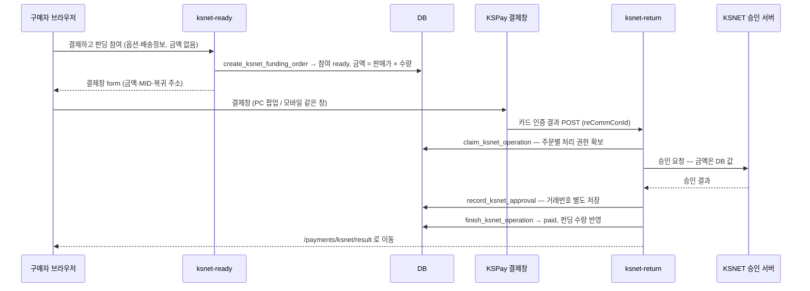

# KSNET 결제 연동 가이드

펀딩 참여 결제를 **KSNET(KSPay) 카드 인증결제**로 받는다. 모의결제(`mock`)를 대체한다.

| | |
|---|---|
| 결제 방식 | **1회성 카드 결제** (결제창 안의 간편결제 포함). 정기결제(빌링)는 없다 |
| 적용 범위 | 펀딩 참여(`/fundings/:id` → 주문하기)만. 제작 견적·단체복 요청은 결제가 없다 |
| 필요한 계약 | KSNET **인증결제 MID** 1개와 그 MID 의 취소(pgapi) 인증키 |
| 모의결제 | 운영 전환 마이그레이션이 브라우저의 모의결제 RPC 실행 권한을 제거한다. 프론트 상수만 바꿔서는 모의결제를 재개할 수 없다 |

## 결제 흐름



**금액은 브라우저가 정하지 않는다.** 결제창은 카드 인증까지만 하고, 승인은 `ksnet-return` 이
DB 금액으로 KSNET 에 직접 건다. 결제창 form 이나 리턴값을 조작해도 승인 금액은 바뀌지 않는다.

### 결제 상태

| `payment_status` | 뜻 | 펀딩 수량 반영 |
|---|---|:-:|
| `ready` | 승인 대기 또는 결과 확인 중. 승인 요청 후에는 처리 잠금으로 재승인을 막는다 | ❌ |
| `paid` | KSNET 승인 완료 | ✅ |
| `failed` | 승인 거절·오류 | ❌ |
| `cancelled` | 결제창에서 취소, 또는 결제 후 취소(환불) | ❌ |

### 동시 요청과 결과 유실 처리

- `ksnet_payment_operations`에 승인/환불 처리 권한을 먼저 저장한다. 같은 주문에는 진행 중인 작업이 하나만 존재할 수 있다. 구매자·판매자 취소도 같은 경로를 사용한다.
- 결제창 취소는 DB 행 잠금 안에서 `ready`이고 승인 작업이 시작되지 않은 경우만 처리한다. 승인 중이거나 이미 결제된 주문은 바꾸지 않는다.
- 승인 응답의 **주문번호·금액·거래번호**를 확인한다. 거래번호를 먼저 별도 트랜잭션으로 기록하고, 주문 확정 실패나 주문 정보 불일치 시 자동 취소한다. 다른 주문에서 사용한 거래번호는 임의 취소하지 않고 확인 대상으로 남긴다.
- 승인 또는 취소 응답이 끊기면 결과를 실패로 단정하지 않는다. `review_required`와 거래 기록을 남기고 자동 재시도하지 않는다. 프로세스가 중단돼 `processing`으로 남은 작업도 자동 해제하지 않는다.
- 같은 구매자가 해당 펀딩의 새 주문을 만드는 것도 기존 승인/환불 결과가 미확정인 동안 차단한다.
- 승인 처리 중인 주문이 있으면 조기 마감도 중단된다. 승인 결과 확인 후 다시 마감한다. 승인 전 주문만 있는 경우에는 기존 조기 마감대로 주문을 취소하며, 뒤늦은 승인 요청은 차단한다.
- DB 확정 응답만 유실된 경우에는 저장된 작업 결과를 조회한다. 이미 확정됐다면 자동 환불하지 않는다.
- 결과 화면은 `ready`를 “결제 확인 중”으로 표시하고 재결제를 권하지 않는다. 내 펀딩에서도 확인 중인 주문을 볼 수 있다.
- 승인 확정·취소·실패 RPC 및 모의결제 RPC는 `anon`/`authenticated`가 실행할 수 없다. PG 인증 식별자와 작업 기록은 브라우저에 공개하지 않는다.

## 변경 파일

| 구분 | 파일 | 내용 |
|---|---|---|
| DB | `supabase/migrations/20261018020000_enable_ksnet_funding_payment.sql` | `create_ksnet_funding_order` · `payment_provider` 에 `ksnet` · 판매자/관리자 실결제 매출 집계를 "모의결제 외 전체"로 |
| DB 보강 | `supabase/migrations/20261019000000_harden_ksnet_payments.sql` | 결제 RPC 권한 제한, 모의결제 차단, 승인·환불 처리 잠금과 복구 기록 |
| 처리 흐름 | `supabase/functions/_shared/ksnet-payment.ts` | 중복 방지, 자동 취소, 결과 유실 대응 |
| Edge Function | `supabase/functions/_shared/ksnet.ts` | 결제창 form · 인증 결과 파싱 · 승인 · 취소 (+ `ksnet.test.ts`) |
| | `supabase/functions/ksnet-ready/` | 결제 대기 참여 생성 + 결제창 form |
| | `supabase/functions/ksnet-return/` | 결제창 복귀 → 승인 → 확정 (**JWT 검증 끔**) |
| | `kakaopay-cancel/`, `creator-cancel-participation/` | 구매자·판매자 취소 시 KSNET 결제 건도 환불 |
| 화면 | `src/services/payment/KsnetProvider.ts`, `kspay.ts` | 결제 제공자 · 결제창 열기/닫힘 감지 |
| | `src/components/funding/FundingCheckoutDialog.tsx` | 결제창 호출, 실결제일 때 모의결제 문구 숨김 |
| | `src/pages/KsnetPayResult.tsx` | 결제 결과 화면 (`/payments/ksnet/result`) — DB 상태를 그대로 보여준다 |
| 설정 | `supabase/config.toml` | `ksnet-ready` JWT 검증, `ksnet-return` JWT 검증 끔 |
| | `src/lib/supabase.ts`, `src/integrations/supabase/client.ts` | 환경변수를 먼저 읽고 없으면 기존 운영 값 (로컬 DB 로 띄우기 위해) |

## 환경변수 (Edge Function secrets)

| 이름 | 필수 | 값 |
|---|:-:|---|
| `KSNET_MID` | ✅ | **인증결제** 상점아이디 10자리. KStA → PG 상점정보. 정기결제 MID 를 넣으면 승인이 안 난다 |
| `KSNET_AUTH_HEADER` | ✅ | 취소 API 인증키. KStA → PG 상점정보 → 하단 pgapi. `base64(상점아이디:인증키)` 형태이고 앞의 `pgapi ` 는 붙여도 안 붙여도 된다. **없으면 환불이 실패한다**(취소 처리도 안 된다) |
| `APP_URL` | ✅ | 결제 후 돌아갈 사이트 주소. 예: `https://brand-er1.github.io/clothology-express` |
| `KSNET_RETURN_URL` | | 결제창이 돌아올 주소. 기본 `${SUPABASE_URL}/functions/v1/ksnet-return`. 쿼리 포함 **100자 이하**여야 한다 (KSPay 제한) |
| `KSNET_API_BASE` | | 취소 API 주소. 기본은 운영 `https://pay.ksnet.co.kr`. 시험 때만 `https://paydev.ksnet.co.kr` |

`KSNET_MID` 는 결제창 form 에 실려 브라우저에 보이므로 비밀이 아니다. **`KSNET_AUTH_HEADER` 는
환불을 걸 수 있는 키다.** 문서·채팅·이슈에 붙여넣지 말고 `supabase secrets set` 으로만 넣는다.

## 운영 배포

PR에서는 테스트·타입 검사만 실행한다. main 반영 시 검사가 통과한 뒤 **필수 시크릿 이름 확인 → DB 마이그레이션 → Edge Functions → 프론트** 순서로 배포한다. 백엔드 실패 시 프론트 배포를 중단한다. 시크릿의 실제 MID·키 유효성은 소액 실결제로 별도 확인해야 한다.

수동 배포도 같은 순서를 따른다. 기존 모의결제 권한은 DB 단계에서 제거되므로 전환 시간 동안 주문을 받지 않는 일정으로 진행한다.

```sh
# 1. 시크릿을 먼저 설정한다
supabase secrets set KSNET_MID=<인증결제 MID> KSNET_AUTH_HEADER=<pgapi 키> APP_URL=<사이트 주소>

# 2. DB — 20261018020000, 20261019000000 모두 적용
supabase db push

# 3. 함수 — ksnet-return 은 반드시 JWT 검증을 끈다 (KSPay 는 Supabase 토큰이 없다)
supabase functions deploy ksnet-ready
supabase functions deploy ksnet-return --no-verify-jwt
supabase functions deploy kakaopay-approve
supabase functions deploy kakaopay-cancel
supabase functions deploy creator-cancel-participation

# 4. 프론트 빌드·배포 (기존 방식 그대로)
```

### 운영 전환 체크리스트

- [ ] 실 MID 로 **1,000원 결제** → 결과 화면 "펀딩 참여 완료", 펀딩 참여 수량 +1, KStA 거래내역에 승인
- [ ] 같은 건을 내 펀딩에서 **취소** → "취소 및 환불" 성공, KStA 에서 취소 확인
- [ ] **휴대폰**으로 1회 결제 (모바일은 결제창 경로가 다르다)
- [ ] 사이트를 다른 페이지에 **iframe 으로 임베드**해 쓰는 경우(`public/iframe-embed-example.html`) 그 안에서도 결제 (PC 팝업 / 모바일은 iframe 안에서 결제창으로 이동한다)
- [ ] 결제창에서 취소 / 결제창 그냥 닫기 → 수량이 늘지 않는다
- [ ] `KSNET_MID` 가 테스트 MID(`2999199999`)가 아닌지

## 로컬 테스트

운영 DB 를 건드리지 않도록 **로컬 Supabase(Docker)** 로 띄운다. 커밋된 `.env` 와 Supabase
클라이언트 기본값은 운영 DB 를 가리키므로, 그냥 `npm run dev` 하면 페이지만 열어도 운영 DB 에
방문 기록이 쌓인다.

필요한 것: Docker, Supabase CLI, Node, (단위 테스트용) Deno.

```sh
# 1. 초기 스키마 복원 — 운영 초기 스키마가 저장소에 없어서 첫 마이그레이션부터 실패한다.
#    migrations 에 넣되 git 에는 안 올라가게 막는다.
cp docs/local-dev/bootstrap_base_schema.sql supabase/migrations/20260101000000_local_bootstrap_base_schema.sql
echo "supabase/migrations/20260101000000_local_bootstrap_base_schema.sql" >> .git/info/exclude
echo "supabase/.branches/" >> .git/info/exclude

# 2. 로컬 DB (마이그레이션 전부 적용)
supabase start

# 3. 테스트 계정
eval "$(supabase status -o env | grep -E '^(API_URL|ANON_KEY|SERVICE_ROLE_KEY)=')"
for u in seller buyer; do
  curl -s -X POST "$API_URL/auth/v1/admin/users" \
    -H "apikey: $SERVICE_ROLE_KEY" -H "Authorization: Bearer $SERVICE_ROLE_KEY" -H "Content-Type: application/json" \
    -d "{\"email\":\"$u@test.local\",\"password\":\"test1234!\",\"email_confirm\":true,\"user_metadata\":{\"account_type\":\"$u\",\"full_name\":\"테스트$u\"}}"
done

# 4. 시연용 펀딩 (1,000원) — 출력되는 funding_id 를 적어둔다
docker exec -i supabase_db_jwmzjszdjlrqrhadbggr psql -U postgres < docs/local-dev/seed_ksnet_demo.sql

# 5. 프론트가 로컬 DB 를 보게 한다 (*.local 은 gitignore 대상)
#    VITE_PAYMENT_MODE 를 주지 않으면 결제 버튼이 '결제 오픈 준비 중' 으로 꺼진다(docs/SELLER_CENTER.md)
cat > .env.local <<EOF
VITE_SUPABASE_PROJECT_ID="local"
VITE_SUPABASE_URL="$API_URL"
VITE_SUPABASE_PUBLISHABLE_KEY="$ANON_KEY"
VITE_PAYMENT_MODE="test"
EOF

# 6. Edge Function 환경변수 — KSNET 매뉴얼 샘플 테스트 상점아이디
cat > supabase/functions/.env.local <<'EOF'
KSNET_MID=2999199999
KSNET_API_BASE=https://paydev.ksnet.co.kr
KSNET_RETURN_URL=http://127.0.0.1:54321/functions/v1/ksnet-return
APP_URL=http://localhost:8080
EOF

# 7. 실행 (터미널 두 개)
supabase functions serve --env-file supabase/functions/.env.local
npm run dev
```

`buyer@test.local` / `test1234!` 로 로그인 → `http://localhost:8080/fundings/<funding_id>` → 주문하기.

- 로컬 `SUPABASE_URL` 은 도커 내부 주소(`http://kong:8000`)라 브라우저가 돌아올 수 없다. 그래서 `KSNET_RETURN_URL` 을 따로 준다.
- 테스트 MID 는 결제창에 상호 `테스트그룹10(주)` 로 뜬다. **테스트 MID 로 실제 카드를 넣었을 때 청구되는지는 확인되지 않았다.** 카드 인증 단계부터는 실 MID 로 확인한다.
- 테스트 MID 용 취소 키는 없다. 로컬에서 환불을 누르면 `KSNET_AUTH_HEADER 가 설정되지 않았습니다` 로 거절되고 결제 상태는 그대로다 — 의도된 동작이다.

### 자동 테스트

```sh
npm test                    # 프론트 Vitest만 실행
npm run test:payments       # 어댑터 + 승인/환불 회귀 테스트 (외부 PG 호출 없음)
npm run check:payments      # 결제 Edge Functions 타입 검사
python3 scripts/payment-db-tests/run.py --container supabase_db_jwmzjszdjlrqrhadbggr
# 마지막 명령은 로컬 DB 스키마와 마이그레이션 이름만 읽어 임시 DB를 만든다.
# 미적용 마이그레이션을 임시 DB에 적용한 뒤 권한·상태 전이·동시 세션을 검사한다.
# 테스트 데이터는 자체 생성하며 완료/실패 시 임시 DB를 삭제한다. 원본 DB는 변경하지 않는다.
```

## 보강 검증 (2026-10-19)

- 어댑터 16개 + 승인/환불 회귀 19개: 동시 승인, 승인 중/승인 후 취소, 구매자·판매자 동시 환불, 금액/주문번호 불일치, 승인 거절, PG 타임아웃, 확정 실패, 커밋 응답 유실, 환불 실패와 환불 후 DB 실패를 검증한다.
- PostgreSQL: 비로그인 결제 확정 및 모의결제 권한 차단, 비공개 거래 기록, 금액 계산, 중복 확정 시 수량 1회 반영, 기존 취소 RPC의 잠금 우회 차단, 소유자 검증, 제작자 취소 알림 유지, 자동 취소와 확인 필요 상태를 검증한다. 실제 DB 세션 두 개로 동시 승인 권한 획득이 1회인지 검사한다.
- 최신 `main` 통합 후 프론트 137개, 결제 35개와 DB 회귀 검사를 실행한다. DB 검사는 최신 마이그레이션 적용 및 조기 마감과 결제 승인 사이의 충돌도 포함한다.
- **실제 카드 승인·환불·모바일·iframe 검증은 여전히 미완료**다. 위 테스트는 PG를 모의 처리하며 운영 DB에 연결하지 않는다.

## 최초 연동 테스트 기록 (2026-09-29, 로컬)

| 항목 | 방법 | 결과 |
|---|---|:-:|
| KSNET 어댑터 (form·파싱·승인 응답 EUC-KR·취소 성공/거절/키 없음) | Deno 단위 테스트 16개 | ✅ |
| 결제 대기 참여 생성, 금액 = 판매가 × 수량 | `ksnet-ready` 호출 | ✅ |
| 잘못된 옵션 → DB 사유("선택할 수 없는 컬러입니다.") 표시 | `ksnet-ready` 호출 | ✅ |
| KSPay 결제창 표시 (테스트 상점, 1,000원) | 브라우저 (PC) | ✅ |
| 결제창을 그냥 닫기 → 화면 잠금 해제·안내 | 브라우저 (PC) | ✅ |
| 결제창에서 취소 → `cancelled`, 수량 미반영 | `ksnet-return` 에 취소 POST | ✅ |
| 승인 거절 → `failed`, 수량 미반영 | 가짜 거래 ID 로 실제 KSNET 승인 서버 호출 | ✅ |
| 위조 요청 (없는 주문 키, 빈 본문) → 아무것도 안 바뀜 | `ksnet-return` 에 POST | ✅ |
| 승인 후 확정 → `paid`, 수량 반영, 두 번 확정해도 한 번만 반영 | 승인 이후 DB 호출을 그대로 재현 | ✅ |
| 판매자 대시보드 실결제 매출에 KSNET 포함 | 위 결과로 조회 | ✅ |
| 결과 화면 (완료·취소·미완료), 내 펀딩 "실제결제"·환불 문구 | 브라우저 | ✅ |
| 환불 키 없을 때 구매자·판매자 취소 모두 거절, 상태 유지 | 함수 호출 | ✅ |
| 기존 테스트 64개, lint, 빌드 | `npm test`, `eslint`, `npm run build` | ✅ |
| **실제 카드 승인** (`ksnet-return` 승인 성공 분기) | — | ⏳ 실 MID 필요 |
| **환불 API 실호출** | — | ⏳ 실 MID·키 필요 |
| **모바일 결제창** (`KSPayMobileV1.4`) | — | ⏳ 실기기 필요 |
| **iframe 임베드 환경** 결제 | — | ⏳ 실환경 필요 |
| 승인 후 확정 실패 → 자동 취소 | — | ⏳ 실 MID 필요 |

⏳ 항목은 위 "운영 전환 체크리스트"로 확인한다. 승인·취소 코드는 플리트소프트가 같은 KSPay
규격으로 운영 중인 구현을 옮긴 것이다.

## 주의

- **마이그레이션 번호.** 최신 `main`의 상세페이지 마이그레이션과 겹치지 않도록 최초 KSNET
  마이그레이션을 `20261018020000`으로 변경했다. 고객 운영 DB에는 이 최종 파일을 적용한다.
- **결제창을 그냥 닫은 참여는 `ready` 로 남는다.** 수량에는 반영되지 않는다. 결제에 성공했는데
  창만 먼저 닫힌 경우와 구분할 수 없어서 자동으로 취소하지 않는다(카카오페이 흐름과 같다).
- **전액 취소만 있다.** 부분취소는 구현하지 않았다.
- **KSNET 에는 거래 조회 API 가 없다.** 취소가 `P10Q`(취소거절)로 오면 이미 취소된 건인지
  기간 초과인지 알 수 없어 상태를 바꾸지 않는다. KStA 에서 사람이 확인한다.
- **관리자 환불 화면은 PG API 를 부르지 않는다**(기존 정책). 관리자 환불은 KStA 에서 취소한 뒤
  확인 처리한다. 구매자·판매자 취소 버튼만 KSNET 취소 API 로 자동 환불한다.
- **최소 결제금액 1,000원.** 미만이면 결제창을 열기 전에 막는다.
- 승인은 났는데 DB 확정이 실패하면 자동으로 KSNET 취소를 시도한다. 그것도 실패하면
  작업이 `review_required`로 남고 `KSNET 결과 확인 필요` 로그에 작업 ID와 거래번호가 기록된다.

## 문제 해결

| 증상 | 원인 · 조치 |
|---|---|
| 결제창이 안 뜨고 "결제창이 닫혔습니다" 안내만 나온다 | 브라우저 팝업 차단. PC 는 팝업, 모바일은 같은 창으로 이동한다 |
| 결제창을 닫았는데 화면이 회색으로 덮여 있다 | KSPay 딤. `clearKspayLayer()` 가 걷는다 — 코드가 바뀌었는지 확인 |
| 결제 후 흰 화면이거나 사이트로 안 돌아온다 | `APP_URL` 누락, 또는 `ksnet-return` 을 JWT 검증 켠 채 배포(401) |
| "KSNET 복귀 주소가 100자를 넘습니다" | 커스텀 도메인 등으로 함수 주소가 길다. 짧은 `KSNET_RETURN_URL` 지정 |
| 환불 시 `A0403` | `KSNET_AUTH_HEADER` 형식 오류 또는 다른 MID 의 키 |
| 환불 시 "KSNET 이 결제 취소를 거절했습니다" (`P10Q`) | 이미 취소됐거나 취소 가능 기간 초과. KStA 에서 확인 |
| 승인이 계속 거절된다 | 정기결제 MID 를 넣었거나 MID 미개시. `failed` 참여의 `payment_payload.message` 확인 |

로그는 Supabase 대시보드 → Edge Functions → `ksnet-ready` / `ksnet-return` 에서 본다.

## 결과 확인이 필요한 작업 복구

Supabase SQL Editor 등 서버 관리자 권한으로 `ksnet_payment_operations`의 `processing`/`review_required` 작업을 조회한다. 테이블의 `tid`, `payload`, `comm_con_id`와 KStA 거래내역을 대조한다. 이 값은 공유 문서나 브라우저에 공개하지 않는다.

1. 먼저 원래 Edge Function 실행이 종료됐는지 확인한다. 진행 중인 요청과 동시에 복구하지 않는다.
2. 승인 여부가 불명확하면 KSNET에 확인한다. 작업을 삭제하거나 잠금을 시간만으로 해제하지 않는다.
3. 실제 승인이 있고 주문에 반영할 경우, `record_ksnet_approval`에 확인한 거래번호와 `order_no`·`amount`·`auth_no`를 기록한 뒤 `finish_ksnet_operation(..., 'paid', ...)`로 확정한다. 주문번호와 금액이 일치해야 한다.
4. KStA에서 취소가 확인된 경우 `finish_ksnet_operation(..., 'cancelled', '{"refund_confirmed":true}')`로 DB를 맞춘다. 환불이 성공했지만 DB 반영만 실패한 경우도 **PG 취소를 다시 호출하지 않고** 이 단계만 수행한다.
5. 승인/환불이 실행되지 않았음을 확실히 확인한 경우만 `finish_ksnet_operation(..., 'failed', ...)`로 작업을 닫는다. 승인 작업은 주문도 실패 처리하고, 환불 작업은 원래의 결제 완료 상태를 유지한다.

복구 RPC는 service role 전용이다. 서비스 키를 브라우저나 고객에게 전달하지 않는다.
