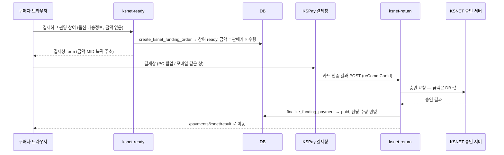

# KSNET 결제 연동 가이드

펀딩 참여 결제를 **KSNET(KSPay) 카드 인증결제**로 받는다. 모의결제(`mock`)를 대체한다.

| | |
|---|---|
| 결제 방식 | **1회성 카드 결제** (결제창 안의 간편결제 포함). 정기결제(빌링)는 없다 |
| 적용 범위 | 펀딩 참여(`/fundings/:id` → 주문하기)만. 제작 견적·단체복 요청은 결제가 없다 |
| 필요한 계약 | KSNET **인증결제 MID** 1개와 그 MID 의 취소(pgapi) 인증키 |
| 되돌리기 | `src/services/payment/index.ts` 의 `ACTIVE_PAYMENT_PROVIDER` 를 `"mock"` 으로 |

## 결제 흐름



**금액은 브라우저가 정하지 않는다.** 결제창은 카드 인증까지만 하고, 승인은 `ksnet-return` 이
DB 금액으로 KSNET 에 직접 건다. 결제창 form 이나 리턴값을 조작해도 승인 금액은 바뀌지 않는다.

### 결제 상태

| `payment_status` | 뜻 | 펀딩 수량 반영 |
|---|---|:-:|
| `ready` | 결제창을 열었고 아직 승인 전 | ❌ |
| `paid` | KSNET 승인 완료 | ✅ |
| `failed` | 승인 거절·오류 | ❌ |
| `cancelled` | 결제창에서 취소, 또는 결제 후 취소(환불) | ❌ |

## 변경 파일

| 구분 | 파일 | 내용 |
|---|---|---|
| DB | `supabase/migrations/20261001000000_enable_ksnet_funding_payment.sql` | `create_ksnet_funding_order` · `payment_provider` 에 `ksnet` · 판매자/관리자 실결제 매출 집계를 "모의결제 외 전체"로 |
| Edge Function | `supabase/functions/_shared/ksnet.ts` | 결제창 form · 인증 결과 파싱 · 승인 · 취소 (+ `ksnet.test.ts`) |
| | `supabase/functions/ksnet-ready/` | 결제 대기 참여 생성 + 결제창 form |
| | `supabase/functions/ksnet-return/` | 결제창 복귀 → 승인 → 확정 (**JWT 검증 끔**) |
| | `kakaopay-cancel/`, `creator-cancel-participation/` | 구매자·판매자 취소 시 KSNET 결제 건도 환불 |
| 화면 | `src/services/payment/KsnetProvider.ts`, `kspay.ts` | 결제 제공자 · 결제창 열기/닫힘 감지 |
| | `src/components/funding/FundingCheckoutDialog.tsx` | 결제창 호출, 실결제일 때 모의결제 문구 숨김 |
| | `src/pages/KsnetPayResult.tsx` | 결제 결과 화면 (`/payments/ksnet/result`) — DB 상태를 그대로 보여준다 |
| 설정 | `supabase/config.toml` | `ksnet-ready` JWT 검증, `ksnet-return` JWT 검증 끔 |
| | `src/lib/supabase.ts`, `src/integrations/supabase/client.ts` | 환경변수를 먼저 읽고 없으면 기존 운영 값 (로컬 DB 로 띄우기 위해) |

## 환경변수 (Edge Function secrets)

| 이름 | 필수 | 값 |
|---|:-:|---|
| `KSNET_MID` | ✅ | **인증결제** 상점아이디 10자리. KStA → PG 상점정보. 정기결제 MID 를 넣으면 승인이 안 난다 |
| `KSNET_AUTH_HEADER` | ✅ | 취소 API 인증키. KStA → PG 상점정보 → 하단 pgapi. `base64(상점아이디:인증키)` 형태이고 앞의 `pgapi ` 는 붙여도 안 붙여도 된다. **없으면 환불이 실패한다**(취소 처리도 안 된다) |
| `APP_URL` | ✅ | 결제 후 돌아갈 사이트 주소. 예: `https://brand-er1.github.io/clothology-express` |
| `KSNET_RETURN_URL` | | 결제창이 돌아올 주소. 기본 `${SUPABASE_URL}/functions/v1/ksnet-return`. 쿼리 포함 **100자 이하**여야 한다 (KSPay 제한) |
| `KSNET_API_BASE` | | 취소 API 주소. 기본은 운영 `https://pay.ksnet.co.kr`. 시험 때만 `https://paydev.ksnet.co.kr` |

`KSNET_MID` 는 결제창 form 에 실려 브라우저에 보이므로 비밀이 아니다. **`KSNET_AUTH_HEADER` 는
환불을 걸 수 있는 키다.** 문서·채팅·이슈에 붙여넣지 말고 `supabase secrets set` 으로만 넣는다.

## 운영 배포

```sh
# 1. DB
supabase db push   # 20261001000000_enable_ksnet_funding_payment.sql

# 2. 시크릿
supabase secrets set KSNET_MID=<인증결제 MID> KSNET_AUTH_HEADER=<pgapi 키> APP_URL=<사이트 주소>

# 3. 함수 — ksnet-return 은 반드시 JWT 검증을 끈다 (KSPay 는 Supabase 토큰이 없다)
supabase functions deploy ksnet-ready
supabase functions deploy ksnet-return --no-verify-jwt
supabase functions deploy kakaopay-cancel
supabase functions deploy creator-cancel-participation

# 4. 프론트 빌드·배포 (기존 방식 그대로)
```

### 운영 전환 체크리스트

- [ ] 실 MID 로 **1,000원 결제** → 결과 화면 "펀딩 참여 완료", 펀딩 참여 수량 +1, KStA 거래내역에 승인
- [ ] 같은 건을 내 펀딩에서 **취소** → "취소 및 환불" 성공, KStA 에서 취소 확인
- [ ] **휴대폰**으로 1회 결제 (모바일은 결제창 경로가 다르다)
- [ ] 사이트를 다른 페이지에 **iframe 으로 임베드**해 쓰는 경우(`public/iframe-embed-example.html`) 그 안에서도 결제 (PC 팝업 / 모바일은 iframe 안에서 결제창으로 이동한다)
- [ ] 결제창에서 취소 / 결제창 그냥 닫기 → 수량이 늘지 않는다
- [ ] 무료 반팔 증정 이벤트 문구 정리 (아래 "주의" 참고)
- [ ] `KSNET_MID` 가 테스트 MID(`2999199999`)가 아닌지

## 로컬 테스트

운영 DB 를 건드리지 않도록 **로컬 Supabase(Docker)** 로 띄운다. 커밋된 `.env` 와 Supabase
클라이언트 기본값은 운영 DB 를 가리키므로, 그냥 `npm run dev` 하면 페이지만 열어도 운영 DB 에
방문 기록이 쌓인다.

필요한 것: Docker, Supabase CLI, Node, (단위 테스트용) Deno.

```sh
# 1. 초기 스키마 복원 — 운영 초기 스키마가 저장소에 없어서 첫 마이그레이션부터 실패한다.
#    migrations 에 넣되 git 에는 안 올라가게 막는다.
cp docs/local-dev/bootstrap_base_schema.sql supabase/migrations/20260101000000_local_bootstrap_base_schema.sql
echo "supabase/migrations/20260101000000_local_bootstrap_base_schema.sql" >> .git/info/exclude
echo "supabase/.branches/" >> .git/info/exclude

# 2. 로컬 DB (마이그레이션 전부 적용)
supabase start

# 3. 테스트 계정
eval "$(supabase status -o env | grep -E '^(API_URL|ANON_KEY|SERVICE_ROLE_KEY)=')"
for u in seller buyer; do
  curl -s -X POST "$API_URL/auth/v1/admin/users" \
    -H "apikey: $SERVICE_ROLE_KEY" -H "Authorization: Bearer $SERVICE_ROLE_KEY" -H "Content-Type: application/json" \
    -d "{\"email\":\"$u@test.local\",\"password\":\"test1234!\",\"email_confirm\":true,\"user_metadata\":{\"account_type\":\"$u\",\"full_name\":\"테스트$u\"}}"
done

# 4. 시연용 펀딩 (1,000원) — 출력되는 funding_id 를 적어둔다
docker exec -i supabase_db_jwmzjszdjlrqrhadbggr psql -U postgres < docs/local-dev/seed_ksnet_demo.sql

# 5. 프론트가 로컬 DB 를 보게 한다 (*.local 은 gitignore 대상)
cat > .env.local <<EOF
VITE_SUPABASE_PROJECT_ID="local"
VITE_SUPABASE_URL="$API_URL"
VITE_SUPABASE_PUBLISHABLE_KEY="$ANON_KEY"
EOF

# 6. Edge Function 환경변수 — KSNET 매뉴얼 샘플 테스트 상점아이디
cat > supabase/functions/.env.local <<'EOF'
KSNET_MID=2999199999
KSNET_API_BASE=https://paydev.ksnet.co.kr
KSNET_RETURN_URL=http://127.0.0.1:54321/functions/v1/ksnet-return
APP_URL=http://localhost:8080
EOF

# 7. 실행 (터미널 두 개)
supabase functions serve --env-file supabase/functions/.env.local
npm run dev
```

`buyer@test.local` / `test1234!` 로 로그인 → `http://localhost:8080/fundings/<funding_id>` → 주문하기.

- 로컬 `SUPABASE_URL` 은 도커 내부 주소(`http://kong:8000`)라 브라우저가 돌아올 수 없다. 그래서 `KSNET_RETURN_URL` 을 따로 준다.
- 테스트 MID 는 결제창에 상호 `테스트그룹10(주)` 로 뜬다. **테스트 MID 로 실제 카드를 넣었을 때 청구되는지는 확인되지 않았다.** 카드 인증 단계부터는 실 MID 로 확인한다.
- 테스트 MID 용 취소 키는 없다. 로컬에서 환불을 누르면 `KSNET_AUTH_HEADER 가 설정되지 않았습니다` 로 거절되고 결제 상태는 그대로다 — 의도된 동작이다.

### 자동 테스트

```sh
deno test --no-lock --allow-env --allow-net=jsr.io supabase/functions/_shared/ksnet.test.ts   # KSNET 어댑터 16개
npm test                                                                          # 기존 vitest
```

## 테스트 현황 (2026-09-29, 로컬)

| 항목 | 방법 | 결과 |
|---|---|:-:|
| KSNET 어댑터 (form·파싱·승인 응답 EUC-KR·취소 성공/거절/키 없음) | Deno 단위 테스트 16개 | ✅ |
| 결제 대기 참여 생성, 금액 = 판매가 × 수량 | `ksnet-ready` 호출 | ✅ |
| 잘못된 옵션 → DB 사유("선택할 수 없는 컬러입니다.") 표시 | `ksnet-ready` 호출 | ✅ |
| KSPay 결제창 표시 (테스트 상점, 1,000원) | 브라우저 (PC) | ✅ |
| 결제창을 그냥 닫기 → 화면 잠금 해제·안내 | 브라우저 (PC) | ✅ |
| 결제창에서 취소 → `cancelled`, 수량 미반영 | `ksnet-return` 에 취소 POST | ✅ |
| 승인 거절 → `failed`, 수량 미반영 | 가짜 거래 ID 로 실제 KSNET 승인 서버 호출 | ✅ |
| 위조 요청 (없는 주문 키, 빈 본문) → 아무것도 안 바뀜 | `ksnet-return` 에 POST | ✅ |
| 승인 후 확정 → `paid`, 수량 반영, 두 번 확정해도 한 번만 반영 | 승인 이후 DB 호출을 그대로 재현 | ✅ |
| 판매자 대시보드 실결제 매출에 KSNET 포함 | 위 결과로 조회 | ✅ |
| 결과 화면 (완료·취소·미완료), 내 펀딩 "실제결제"·환불 문구 | 브라우저 | ✅ |
| 환불 키 없을 때 구매자·판매자 취소 모두 거절, 상태 유지 | 함수 호출 | ✅ |
| 기존 테스트 64개, lint, 빌드 | `npm test`, `eslint`, `npm run build` | ✅ |
| **실제 카드 승인** (`ksnet-return` 승인 성공 분기) | — | ⏳ 실 MID 필요 |
| **환불 API 실호출** | — | ⏳ 실 MID·키 필요 |
| **모바일 결제창** (`KSPayMobileV1.4`) | — | ⏳ 실기기 필요 |
| **iframe 임베드 환경** 결제 | — | ⏳ 실환경 필요 |
| 승인 후 확정 실패 → 자동 취소 | — | ⏳ 실 MID 필요 |

⏳ 항목은 위 "운영 전환 체크리스트"로 확인한다. 승인·취소 코드는 플리트소프트가 같은 KSPay
규격으로 운영 중인 구현을 옮긴 것이다.

## 주의

- **무료 반팔 증정 이벤트(~10.10).** 홈·펀딩 목록 배너, 상세, 결제 단계에 "모의결제로 참여하면
  실제 결제 없이 무료로 보내드려요" / "모의결제 0원" 이 나온다(`src/components/funding/FreeTeeEvent.tsx`).
  실결제로 전환하면 **돈을 받으면서 이 문구가 뜬다.** 프로모션 정책이라 코드는 건드리지 않았다.
  이벤트 종료 후 전환하거나 문구를 정리해야 한다.
- **결제창을 그냥 닫은 참여는 `ready` 로 남는다.** 수량에는 반영되지 않는다. 결제에 성공했는데
  창만 먼저 닫힌 경우와 구분할 수 없어서 자동으로 취소하지 않는다(카카오페이 흐름과 같다).
- **전액 취소만 있다.** 부분취소는 구현하지 않았다.
- **KSNET 에는 거래 조회 API 가 없다.** 취소가 `P10Q`(취소거절)로 오면 이미 취소된 건인지
  기간 초과인지 알 수 없어 상태를 바꾸지 않는다. KStA 에서 사람이 확인한다.
- **관리자 환불 화면은 PG API 를 부르지 않는다**(기존 정책). 관리자 환불은 KStA 에서 취소한 뒤
  확인 처리한다. 구매자·판매자 취소 버튼만 KSNET 취소 API 로 자동 환불한다.
- **최소 결제금액 1,000원.** 미만이면 결제창을 열기 전에 막는다.
- 승인은 났는데 DB 확정이 실패하면 자동으로 KSNET 취소를 시도한다. 그것도 실패하면
  `ksnet-return rollback 실패 — KStA 에서 수동 취소 필요` 로그가 tid 와 함께 남는다.

## 문제 해결

| 증상 | 원인 · 조치 |
|---|---|
| 결제창이 안 뜨고 "결제창이 닫혔습니다" 안내만 나온다 | 브라우저 팝업 차단. PC 는 팝업, 모바일은 같은 창으로 이동한다 |
| 결제창을 닫았는데 화면이 회색으로 덮여 있다 | KSPay 딤. `clearKspayLayer()` 가 걷는다 — 코드가 바뀌었는지 확인 |
| 결제 후 흰 화면이거나 사이트로 안 돌아온다 | `APP_URL` 누락, 또는 `ksnet-return` 을 JWT 검증 켠 채 배포(401) |
| "KSNET 복귀 주소가 100자를 넘습니다" | 커스텀 도메인 등으로 함수 주소가 길다. 짧은 `KSNET_RETURN_URL` 지정 |
| 환불 시 `A0403` | `KSNET_AUTH_HEADER` 형식 오류 또는 다른 MID 의 키 |
| 환불 시 "KSNET 이 결제 취소를 거절했습니다" (`P10Q`) | 이미 취소됐거나 취소 가능 기간 초과. KStA 에서 확인 |
| 승인이 계속 거절된다 | 정기결제 MID 를 넣었거나 MID 미개시. `failed` 참여의 `payment_payload.message` 확인 |

로그는 Supabase 대시보드 → Edge Functions → `ksnet-ready` / `ksnet-return` 에서 본다.
